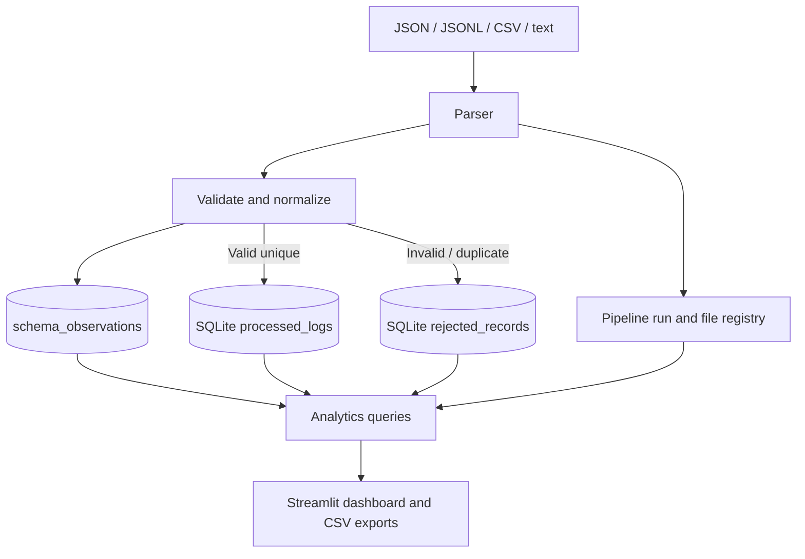

# Architecture

`parser.py` converts formats to source rows while retaining source position and payload. `validation.py` applies required field, timestamp, severity, latency and fingerprint rules. `pipeline.py` fingerprints source field sets, records additive/incompatible changes, and coordinates deduplication, quarantine and atomic batch writes. A failed batch rolls back; earlier committed batches remain and are treated as duplicates on retry. `database.py` initializes indexed SQLite tables and enforces the `run_id` foreign key. No domain reference dimensions exist in this log schema. `analytics.py` derives metrics from persisted data. `app.py` presents three focused pages and schema warnings. The default database lives at `data/loglens.db`; all source files remain local.
